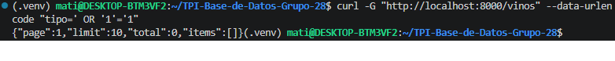
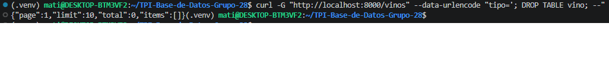
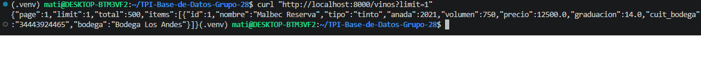

# API REST - Bodegas del Atuel (Etapa 6)

FastAPI + psycopg 3 (SQL puro, sin ORM). Conecta con el rol `app_rw`.

## Levantar todo
```bash
docker compose up -d --build        # DB con migraciones 001-008 + API en :8000
# Primera vez, cargar datos (como postgres, puerto 5433):
pip install -r db/seed/requirements.txt
python db/seed/cargar_catalogos.py
python db/seed/generar_datos.py --seed 42 --fecha-ref 2026-11-08
```
Swagger: http://localhost:8000/docs

> Las migraciones solo corren cuando el volumen está vacío. Para reaplicarlas:
> `docker compose down -v && docker compose up -d --build`.

## Correr las pruebas (con la base levantada y cargada)
```bash
cd api
python -m venv .venv && source .venv/bin/activate
pip install -r requirements-dev.txt
cp .env.example .env                # DB_HOST=localhost, DB_PORT=5433
pytest -v
```

## Prueba de inyección SQL

Prueba realizada contra `GET /vinos?tipo=...` para verificar que los valores de
usuario se envían como parámetros y no se concatenan en el SQL. Las capturas de
pantalla y la salida textual se guardan en `../docs/inyeccion-sql/` (relativo a
este README).

### Reproducción

```bash
# Entorno limpio (OJO: down -v borra la base local del volumen)
docker compose down -v
docker compose up -d --build

# Esperar a que PostgreSQL esté healthy
until [ "$(docker inspect -f '{{.State.Health.Status}}' postgres-bodega)" = healthy ]; do
  sleep 2
done

# Dependencias y datos
python3 -m venv .venv
source .venv/bin/activate
pip install -r db/seed/requirements.txt
python db/seed/cargar_catalogos.py
python db/seed/generar_datos.py --seed 42 --fecha-ref 2026-11-08
```

Si la base ya tiene datos y no querés recrear el volumen, ejecutá el generador
con `--reset`.

### Comandos ejecutados

```bash
# 1) Tipo inyectado
curl -i -G "http://localhost:8000/vinos" \
  --data-urlencode "tipo=' OR '1'='1"

# 2) Intento de DROP TABLE
curl -i -G "http://localhost:8000/vinos" \
  --data-urlencode "tipo='; DROP TABLE vino; --"

# 3) Control: la tabla sigue intacta
curl -i "http://localhost:8000/vinos?limit=1"
```

> `-i` muestra los headers para evidenciar el `HTTP/1.1 200 OK`.

### Evidencia

**1. Payload `' OR '1'='1`**



Salida completa: [`01-payload-or.txt`](../docs/inyeccion-sql/01-payload-or.txt).

Resultado obtenido:

```http
HTTP/1.1 200 OK
content-type: application/json

{"page":1,"limit":10,"total":0,"items":[]}
```

**2. Payload `'; DROP TABLE vino; --`**



Salida completa: [`02-payload-drop.txt`](../docs/inyeccion-sql/02-payload-drop.txt).

Resultado obtenido:

```http
HTTP/1.1 200 OK
content-type: application/json

{"page":1,"limit":10,"total":0,"items":[]}
```

**3. Control `?limit=1`**



Salida completa: [`03-control.txt`](../docs/inyeccion-sql/03-control.txt).

Resultado obtenido:

```json
{"page":1,"limit":1,"total":500,"items":[{"id":1,"nombre":"Malbec Reserva","tipo":"tinto","anada":2021,"volumen":750,"precio":12500.0,"graduacion":14.0,"cuit_bodega":"34443924465","bodega":"Bodega Los Andes"}]}
```

La request de control devuelve vinos reales y `total: 500`, lo que confirma que
la tabla `vino` sigue existiendo después de los dos intentos de inyección.

### Resultado esperado vs obtenido

| Prueba | Esperado | Obtenido |
| --- | --- | --- |
| `tipo=' OR '1'='1` | `200 OK`, sin coincidencias | `200 OK`, `items: []`, `total: 0` |
| `tipo='; DROP TABLE vino; --` | `200 OK`, sin coincidencias | `200 OK`, `items: []`, `total: 0` |
| `?limit=1` | `200 OK`, vino real | `200 OK`, vino real, `total: 500`, tabla intacta |

### Explicación técnica

El filtro se arma en `api/repositories/vinos.py`. El valor de `tipo` no se
concatena al SQL; se agrega a una lista de parámetros y se usa el placeholder
`%s`:

```python
condiciones.append("v.tipo = %s")
params.append(tipo)
```

Luego se ejecuta:

```python
conn.execute(sql, [*params, limit, offset])
```

`psycopg` envía la sentencia SQL y los valores por separado usando el protocolo
extendido de PostgreSQL. PostgreSQL parsea la consulta con un parámetro `$1` y
vincula el valor después. Por eso `' OR '1'='1` y `'; DROP TABLE vino; --` se
comparan como texto literal y nunca se interpretan como SQL.

Como defensa adicional, la API se conecta con el rol `app_rw`, que tiene permisos
DML pero no privilegios de DDL (ver `db/migrations/007_roles.sql`), por lo que
tampoco podría ejecutar un `DROP TABLE` aunque existiera una concatenación.

### Verificación adicional

```bash
docker exec postgres-bodega psql -U postgres -d bodegas_del_atuel \
  -c "SELECT count(*) AS vinos FROM vino;"
```

El conteo debe ser mayor a 0 después de las dos pruebas de inyección.

### Log parametrizado (opcional)

Para ver en el log de PostgreSQL que la consulta usa `$1` y que el valor viaja
aparte:

```bash
docker exec postgres-bodega psql -U postgres -d bodegas_del_atuel \
  -c "ALTER SYSTEM SET log_statement = 'all';" \
  -c "SELECT pg_reload_conf();"

curl -i -G "http://localhost:8000/vinos" \
  --data-urlencode "tipo=' OR '1'='1"

docker compose logs --since=2m db | tail -80

docker exec postgres-bodega psql -U postgres -d bodegas_del_atuel \
  -c "ALTER SYSTEM RESET log_statement;" \
  -c "SELECT pg_reload_conf();"
```

### Ubicación de las capturas

| Archivo | Contenido |
| --- | --- |
| `01-payload-or.png` | Comando con `tipo=' OR '1'='1`, `200 OK` y respuesta vacía. |
| `02-payload-drop.png` | Comando con `tipo='; DROP TABLE vino; --`, `200 OK` y respuesta vacía. |
| `03-control.png` | Comando `?limit=1` devolviendo un vino real y `total` mayor a 0. |
