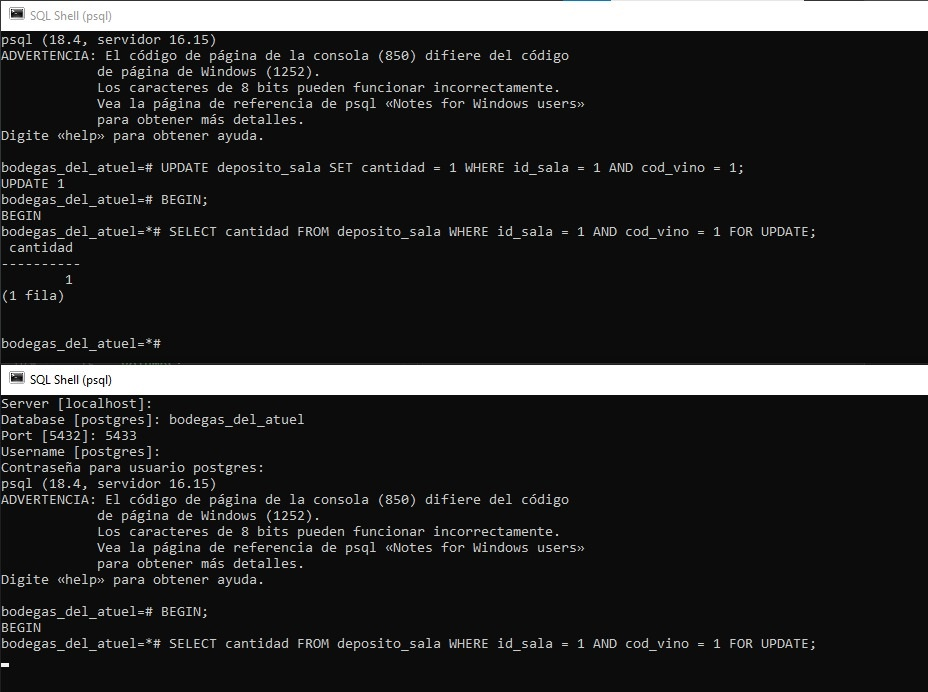
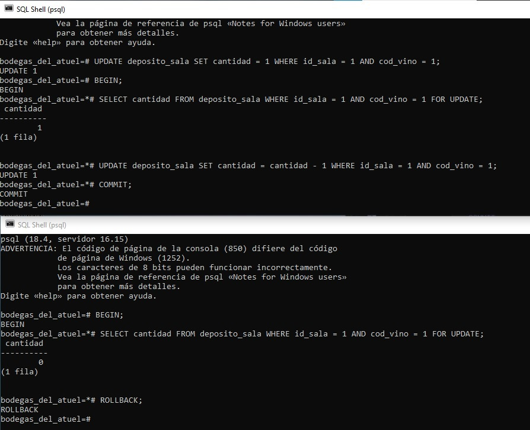

**Informe Técnico – Etapa 2: Integridad Declarativa, Procedural y Concurrencia**

*TPI Base de Datos – Grupo 28 | Sistema de Gestión Vitivinícola «Bodegas del Atuel»*\
*Motor: PostgreSQL 16 (Contenerizado con Docker Compose)*

**1. Introducción y Arquitectura de Integridad en Tres Capas**

El propósito de la Etapa 2 consistió en trasladar y blindar la totalidad de las reglas de negocio y restricciones de consistencia del sistema vitivinícola directamente dentro del motor de base de datos PostgreSQL 16. La estrategia de diseño se estructuró en una jerarquía defensiva de tres niveles complementarios:

**• Capa 1 – Integridad Declarativa (Nivel Motor):** Dominios personalizados (e.g. cuit_dom validado mediante expresiones regulares), tipos de datos estructurados (ENUM) y restricciones CHECK y UNIQUE a nivel de tupla. Resuelven validaciones atómicas inmediatas y previenen inconsistencias de dominio en origen.

**• Capa 2 – Integridad Procedural y Auditoría (Nivel Lógica):** Procedimientos y funciones en PL/pgSQL que orquestan lógica reactiva. Comprende triggers BEFORE (para verificación de stock previo a ventas y validación de estados de documentos), triggers AFTER (para actualización de cabeceras, trazabilidad y auditoría de precios) y un trigger diferido (CONSTRAINT TRIGGER DEFERRABLE INITIALLY DEFERRED) que evalúa la composición del 100% en cortes únicamente al invocar el COMMIT transaccional.

**• Capa 3 – Control Transaccional y Concurrencia (Nivel Operativo):** Procedimientos almacenados para transferencias de stock e ingresos con propiedades ACID garantizadas, complementados con bloqueos pesimistas de fila (SELECT ... FOR UPDATE) bajo el nivel de aislamiento READ COMMITTED para eliminar condiciones de carrera en ventas concurrentes de última unidad.

**2. Matriz de Trazabilidad Exhaustiva de Reglas de Negocio (RN-01 a RN-15)**

A continuación se presenta el mapeo técnico detallado que vincula cada requerimiento funcional exigido por la cátedra con su implementación física en PostgreSQL y su respectivo caso de prueba validado en `tests/db_tests.sql`:

| **Regla** | **Descripción** | **Mecanismo en BD** | **Script / Objeto** | **Validación en db_tests.sql** |
| --- | --- | --- | --- | --- |
| **RN-01** | El precio de un vino es único para la red y mayor a cero. | UNIQUE (nombre, anada, volumen) y CHECK (precio > 0) | `002_constraints.sql` | Inserción con precio negativo (-100.00) rechazada. |
| **RN-02** | Sala en una localidad, un encargado por localidad. | Claves foráneas (FK) y diseño normalizado (3FN). | `001_esquema.sql` `002_constraints.sql` | Intento de insertar sala con código postal inexistente es rechazado. |
| **RN-03** | Cada empleado trabaja en una sola sala. | Clave foránea NOT NULL (id_sala) | `001_esquema.sql` | Intento de empleado con `id_sala = NULL` rechazado por restricción NOT NULL. |
| **RN-04** | Parcela tiene una sola cepa; se cosecha máximo una vez por campaña. | UNIQUE (id_finca, id_parcela, campania) y FK | `002_constraints.sql` | Segunda inserción de cosecha para misma parcela y campaña rechazada. |
| **RN-05** | Los porcentajes de corte suman exactamente 100. | CONSTRAINT TRIGGER diferido (DEFERRABLE INITIALLY DEFERRED) | `trg_corte_suma_100` `005_triggers.sql` | Transacción con 100% permite COMMIT; corte sumando 80% aborta al confirmar. |
| **RN-06** | Descuento depende del tipo: socio 10%, dist 20%, exp 30%. | Función `fn_descuento_cliente` y CHECK (0, 10, 20, 30, 35) | `002_constraints.sql` `003_funciones.sql` | Inserción de cliente con descuento no permitido (15%) rechazada por el motor. |
| **RN-07** | Permisos de exportador: vencimiento posterior a emisión. | CHECK entre columnas (fecha_vencimiento > fecha_emision) | `002_constraints.sql` | Permiso con vencimiento previo a la fecha de emisión rechazado. |
| **RN-08** | El total del comprobante se calcula desde los renglones. | Trigger que materializa totales mediante función `fn_total_comprobante` | `trg_actualizar_stock_y_totales_venta` `005_triggers.sql` | Inserción de detalle actualiza automáticamente subtotales y total en la cabecera. |
| **RN-09** | Venta requiere stock; stock nunca negativo. | Trigger BEFORE INSERT en renglón y CHECK (cantidad >= 0) | `trg_validar_venta_renglon` `005_triggers.sql` | Venta de cantidad mayor al stock en sala lanza RAISE EXCEPTION. |
| **RN-10** | Ingreso: transición de estados lógica (en_confeccion -> terminado -> procesado). | Tipo ENUM, Trigger BEFORE UPDATE y SP de procesamiento | `sp_procesar_ingreso` `004_procedimientos.sql` | Intento de procesar ingreso en estado "en_confeccion" es bloqueado. |
| **RN-11** | Transferencia: estados correctos, fecha inmodificable, descuenta depósito. | Procedimiento almacenado transaccional y validación de fechas/estados | `sp_procesar_transferencia` `004_procedimientos.sql` | Procesamiento abortado y revertido por insuficiencia de stock central. |
| **RN-12** | Renglones bloqueados si el documento no está en confección. | Trigger BEFORE INSERT/UPDATE/DELETE en renglones | `trg_bloquear_renglones_documento` `005_triggers.sql` | Agregar renglón a un ingreso que ya se encuentra "procesado" es rechazado. |
| **RN-13** | Auditoría obligatoria ante cambios de precio en vinos. | Trigger AFTER UPDATE OF precio en tabla vino | `trg_auditar_precio_vino` `005_triggers.sql` | Cambio de precio inserta registro inmutable en auditoria_precio. |
| **RN-14** | No borrar transportista, bodega ni vino con movimientos. | Claves foráneas con ON DELETE RESTRICT | `001_esquema.sql` | Eliminación de un vino que ya posee ventas es rechazada por FK. |
| **RN-15** | Cantidades, superficies y precios positivos. Graduación de 5 a 20. | Restricciones CHECK en columnas correspondientes | `002_constraints.sql` | Inserción de finca con superficie negativa (-5) rechazada por el motor. |

**3. Justificación de Mecanismos Técnicos Clave**

**3.1. Triggers Diferidos para la Regla de Cortes de Uva (RN-05)**

La regla de negocio RN-05 impone que la sumatoria de las proporciones de uvas que conforman un vino de corte debe ser idéntica a 100.00%. Si esta validación se hubiese configurado con un trigger convencional de ejecución inmediata (IMMEDIATE), la inserción del primer componente (por ejemplo, 60% de Malbec) fallaría instantáneamente debido a que la suma parcial aún no alcanza el total requerido.

**•** Decisión de diseño: Se implementó un CONSTRAINT TRIGGER definido como DEFERRABLE INITIALLY DEFERRED sobre la tabla `composicion`. Mediante este mecanismo, PostgreSQL permite registrar múltiples componentes dentro de un bloque transaccional (BEGIN...COMMIT), postergando la ejecución de la función `trg_validar_porcentaje_corte()` exactamente al momento de ejecutar el COMMIT. Si el acumulado es distinto de 100%, la transacción se rechaza de forma indivisible y ejecuta un ROLLBACK automático.

**3.2. Trazabilidad Inmutable de Precios (RN-13)**

Para cumplir con RN-13 sin depender de la confiabilidad de aplicaciones externas, se implementó un trigger AFTER UPDATE OF precio en la tabla `vino`. El mecanismo intercepta cualquier modificación de precios y extrae variables de contexto de sesión del motor: OLD.precio, NEW.precio, CURRENT_DATE, CURRENT_TIME y SESSION_USER. Esto asegura registros inalterables en `auditoria_precio`, permitiendo auditar con exactitud quién y cuándo efectuó cada alteración comercial.

**4. Demostración Experimental de Concurrencia (Anexo A.8)**

Se diseñó una experiencia de laboratorio transaccional sobre dos conexiones independientes conectadas vía SQL Shell a la base `bodegas_del_atuel` en el puerto 5433 del contenedor Docker. El objetivo consistió en evaluar el comportamiento ante la venta simultánea de la última botella en stock (`stock_sala.cantidad = 1`) bajo el nivel de aislamiento estándar READ COMMITTED.

**4.1. Escenario A: Venta Concurrente sin Bloqueo Pesimista (Riesgo de Sobreventa)**

En una prueba sin cláusula FOR UPDATE, ambas terminales ejecutaron simultáneamente `SELECT cantidad FROM stock_sala WHERE id_sala=1 AND cod_vino=1` dentro de bloques BEGIN. Como READ COMMITTED no bloquea lecturas compartidas, ambas sesiones leyeron exitosamente cantidad = 1. Posteriormente, ambas emitieron la actualización `UPDATE stock_sala SET cantidad = cantidad - 1`. Este comportamiento deriva en un conflicto de Lost Update o sobreventa de stock, siendo detenido de manera reactiva por el constraint CHECK (cantidad >= 0), interrumpiendo el flujo operativo de una de las cajas de venta con un error no controlado.

**4.2. Escenario B: Venta Concurrente con Bloqueo Pesimista (SELECT ... FOR UPDATE)**

Para garantizar atomicidad y consistencia en el punto de venta, se ejecutó el procedimiento con bloqueo pesimista a nivel de tupla:

**1. Sesión 1 (Terminal Superior):** Inicia transacción y solicita bloqueo exclusivo de la fila: `BEGIN; SELECT cantidad FROM stock_sala WHERE id_sala = 1 AND cod_vino = 1 FOR UPDATE;`. El motor le otorga el bloqueo exclusivo de fila y retorna cantidad = 1.

**2. Sesión 2 (Terminal Inferior):** Ejecuta de manera concurrente exactamente la misma sentencia: `BEGIN; SELECT cantidad ... FOR UPDATE;`. Al detectar el cerrojo activo en la tupla `stock_sala`, el motor pone a la Sesión 2 en estado de espera activa (bloqueo transaccional), impidiendo lecturas sucias o decisiones con datos desactualizados.

**3. Sesión 1 (Confirmación):** Concreta la venta y libera los recursos: `UPDATE stock_sala SET cantidad = cantidad - 1 ...; COMMIT;`. Al confirmar, la cantidad en base pasa a 0 y el bloqueo se libera.

**4. Sesión 2 (Resolución Consistente):** La terminal se destraba automáticamente en el instante exacto del COMMIT de la Sesión 1. Bajo READ COMMITTED, PostgreSQL re-evalúa la tupla y devuelve cantidad = 0. Al constatar que el inventario se agotó (a través del trigger de la RN-09), el flujo de negocio lanza la excepción esperada o ejecuta limpiamente un ROLLBACK, evitando la sobreventa.

***Evidencia Gráfica del Experimento***

|  |
| --- |
| **Captura 1 – Demostración de Espera Activa por Bloqueo Pesimista:**  Se observa en la ventana superior la Sesión 1 con la fila bloqueada (FOR UPDATE) retornando cantidad = 1. En la ventana inferior, la Sesión 2 ejecuta la misma consulta y queda suspendida en la consola a la espera de la liberación del candado.  **Captura 2 – Resolución Transaccional y Prevención de Sobreventa:**  La Sesión 1 descuenta la unidad y ejecuta COMMIT. En ese mismo instante la Sesión 2 se desbloquea automáticamente, la venta intercepta el stock actualizado (cantidad = 0) y ejecuta ROLLBACK de forma consistente.|

**5. Estado del Entorno y Transición a la Etapa 3**

El entorno de desarrollo ha quedado completamente desacoplado de dependencias locales mediante Docker Compose en el puerto 5433, alojando las tablas del modelo relacional con todas sus restricciones y convenciones de nomenclatura normalizadas (e.g. `stock_sala`, `stock_central`, `composicion`). La totalidad de los casos de prueba unitarios en `tests/db_tests.sql` han arrojado resultados satisfactorios, probando tanto los flujos de éxito como el rechazo documentado en las 15 Reglas de Negocio.